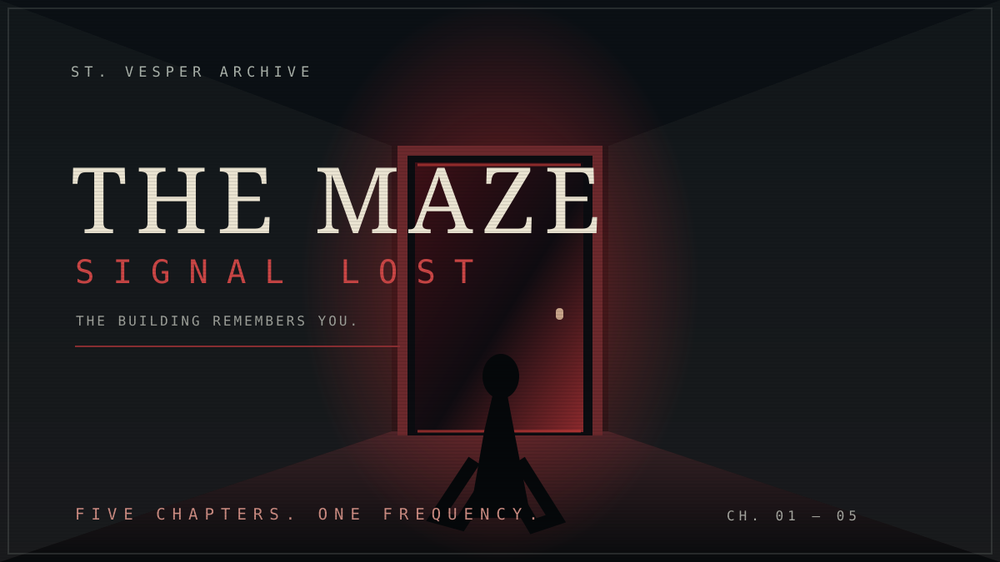

# THE MAZE: SIGNAL LOST

**A five-chapter, first-person, PS1-inspired survival horror shooter and escape game.**



> “They told you the building was empty. The radio has been waiting for you since 1998.”

This project begins with the supplied **Chapter 1 — The Maze** prototype. Its original, standalone HTML build is preserved at [`legacy/chapter-1-original.html`](legacy/chapter-1-original.html). The new game is a separate, maintainable five-chapter campaign with expanded systems and original art/audio.

## Play the game

1. Install **Node.js 20+** (no packages or npm installation required).
2. Run `npm start` in this repository.
3. Open **http://localhost:4173** in a desktop browser; headphones recommended.

Alternatively, run `python3 -m http.server 4173` from the repository root. The game also works on static hosts such as GitHub Pages. The default GitHub Pages URL, after you enable Pages for the main branch, will be `https://ngocdungnguyen.github.io/S/`. Browser ES modules require an HTTP server; opening `index.html` through `file://` may be blocked by browser security restrictions.

## What you can play

| Chapter | Environment | Primary task | Threat |
|---|---|---|---|
| 1: The Maze | Buried intake tunnels | Recover 3 memory fragments and escape through the red door | Watcher: freezes under direct observation |
| 2: The Ward | Abandoned experimental clinic | Recover 3 ID bands, restore the generator, escape | Matron: follows noise, plus Crawlers |
| 3: The Foundry | Underground incineration engine | Close 3 pressure valves and reach the blast gate | Armored Husks and Crawlers |
| 4: The Transmission | Radio array / frequency tunnels | Align 3 relays, activate console, escape | Teleporting Sirens, Matron |
| 5: The Heart | Memory archive core | Break 4 anchors, defeat the Archivist, reach the transmitter | Archivist boss; branching endings |

**Core systems:** first-person raycasting; real-time line-of-sight/pathfinding AI; four weapons with magazines, reserves, recoil and reload; health, battery, stamina, crouching and stealth noise; loot; mini-map; records/journal; music, reactive ambience and effects; save/unlock progression; chapter-end stats; achievements; three endings (including a hidden ending); four difficulty modes; and three special challenges plus campaign.

**Difficulty:** Story, Survivor, Nightmare, No Return (ironman). **Challenges:** The Clock (30 minutes), Blackout (no light), Silent Hands (no firearms). Challenge options remain playable across all five chapters—including a nonlethal finale for Silent Hands.

## Controls

| Action | Input |
|---|---|
| Move / look | WASD + mouse, or arrow keys for look |
| Sprint / crouch | Shift / C or Ctrl |
| Fire / reload | Left mouse or Space / R |
| Interact | E |
| Flashlight | F |
| Select weapons | 1–4 or mouse wheel |
| Journal / map | J / M |
| Pause | Esc |

Mouse input uses Pointer Lock. Click the game viewport to reacquire focus after resuming. The menu contains audio, mouse, brightness, FOV, render scale, scanlines, subtitles, minimap and crosshair controls.

## Project structure

```text
.
├── index.html                     Browser entry point + HUD/menu root
├── styles.css                     Menu, horror UI, HUD and responsive styling
├── src/
│   ├── main.js                    Frontend state machine, UI, save slots, input
│   ├── simulation.js              Movement, maze, enemies, combat, progression
│   ├── render.js                  Software 2.5D raycaster and procedural sprites
│   ├── audio.js                   Interactive Web Audio score and sound effects
│   └── content.js                 Five-chapter campaign, script and balance tables
├── assets/
│   ├── audio/                    Five original 12-second loopable WAV tracks
│   ├── icon.svg                  Original icon
│   └── keyart.svg                Original cover/key art
├── scripts/
│   ├── server.mjs                Dependency-free development server
│   └── generate_audio.py        Deterministic, stdlib WAV-generation pipeline
├── tests/                         Built-in node:test coverage
├── docs/                          Game, story, technical, art, QA and production bibles
├── AGENTS.md                      Specialist roles and contribution protocol
├── .github/workflows/ci.yml       Automated source checks and unit tests
└── legacy/chapter-1-original.html User-supplied standalone prototype (unaltered)
```

## Verify

```sh
npm run check
```

This checks all five JS modules and runs the simulation tests. CI repeats the tests on pull requests and pushes to the default branch.

## Design philosophy

**Survival first.** Weapons stagger or destroy threats, but ammo is precious. Exploring with the flashlight helps reveal the environment but costs battery. Running creates noise. Some creatures require a different response: stare at the Watcher, stay quiet around the Matron, and destroy the Heart's anchors before the Archivist can be harmed.

**Horror through restraint.** Silhouettes, limited sightlines, PS1 texture treatment, red gates, radio interference and an original drone-based score establish a consistent aesthetic. No external runtime dependencies, stock images, or third-party music are required for this edition.

## Development status and limitations

This is a **playable five-chapter pre-release build (v0.9.0)**, not a certified commercially shipped game. Engine logic is tested locally, but exhaustive playtesting, accessibility audits, platform/device testing, professional character animation, voiced dialogue, hand-built level art, and distribution packaging remain production work. The game uses **procedurally generated connected mazes** with different themes, not five hand-authored film-quality environments. See [`docs/REQUIREMENTS.md`](docs/REQUIREMENTS.md) and [`docs/PRODUCTION_BACKLOG.md`](docs/PRODUCTION_BACKLOG.md) for explicit remaining work and definitions of done.

## Licensing

Original game code, authored writing, and generated assets: **MIT License**, see [`LICENSE`](LICENSE). The archived original prototype includes a bundled Three.js library under the **Three.js MIT** license; see [`THIRD_PARTY_NOTICES.md`](THIRD_PARTY_NOTICES.md). No proprietary commercial assets are included. Keep the upstream attribution when distributing the legacy artifact.